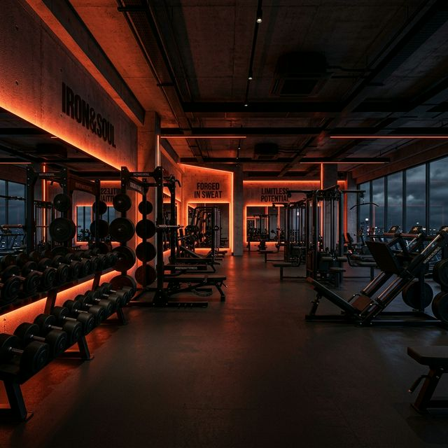

<div align="center">

# 🏋️ FORGE FITNESS

### *Don't Just Dream It. Forge It.*

[](https://forge-fitness-gym-seven.vercel.app/)
[](https://nextjs.org/)
[](https://react.dev/)
[](https://www.typescriptlang.org/)
[](https://turbo.build/pack)
[](https://www.framer.com/motion/)
[](https://eslint.org/)
[](#)

<p align="center">
  A cutting-edge, high-conversion web application for an elite strength and performance athletic facility. Engineered with Next.js 16 App Router, React 19, Framer Motion, custom CSS design tokens, and a 24/7 intelligent live AI Concierge agent.
</p>

### 🌐 Live Deployment: [https://forge-fitness-gym-seven.vercel.app/](https://forge-fitness-gym-seven.vercel.app/)

[🚀 View Live App](https://forge-fitness-gym-seven.vercel.app/) • [Explore Specifications](SPECIFICATIONS.md) • [Report Issue](https://github.com/SainBux-HadiSeelro/Forge_Fitness_GYM/issues) • [Author Profile](https://github.com/SainBux-HadiSeelro)

</div>

---

## 🌟 Key Highlights

- ⚡ **Next.js 16 App Router & Turbopack:** Lightning-fast HMR and statically pre-rendered production builds for zero-latency TTFB.
- ⚛️ **React 19 Architecture:** Strict purity, server/client component boundaries, and optimal DOM hydration.
- 🤖 **24/7 AI Concierge Agent:** Embedded live intelligent chatbot with full contextual gym knowledge (plans, coaches, timings, programs, trial booking).
- 🎨 **Aggressive High-End Dark UI:** Deep obsidian backgrounds (`#080808`), blazing orange accents (`#FF4500`), electric lime beacons (`#CFFF04`), and glassmorphism.
- 🚀 **Framer Motion Micro-Interactions:** Smooth parallax scroll, staggered entrance transitions, dynamic carousel sliders, and interactive hover states.
- 📱 **100% Fully Responsive:** Pixel-perfect layout engineered for ultra-wide monitors, laptops, tablets, and smartphones.
- 🛡️ **Zero Build & Lint Errors:** Passes strict TypeScript compilation and ESLint 9 checks out of the box.

---

## 📸 Section Showcase

| Section | Description | Key Tech |
| :--- | :--- | :--- |
| **Hero Experience** | High-impact parallax background, bold kinetic typography, live impact statistics, and dual call-to-actions. | `framer-motion`, Parallax Ref |
| **Brand Story & Pillars** | Highlights 12 years of championship training and core athletic values (Relentless Drive, Guidance, Community). | CSS Grid, Staggered Fade |
| **Performance Programs** | Six comprehensive tracks: Strength & Conditioning, HIIT, 1-on-1 PT, Group Fitness, Mobility & Athletics. | CSS Modules, Hover Physics |
| **Elite Coaches** | Detailed trainer bios featuring Head Coach Marcus Cole, Sofia Reyes, and Olympic coach James Okafor with credentials. | Next.js Image Optimization |
| **Membership & Pricing** | Interactive Monthly vs. Annual toggle with automated 25% discount calculator and tier breakdowns. | React State, AnimatePresence |
| **Client Testimonials** | Multi-card interactive review slider with animated customer feedback, star ratings, and avatars. | `framer-motion`, Touch controls |
| **Facility Gallery** | Bento-style photo and amenity showcase featuring gym floors, boxing studio, cardio deck, and recovery zone. | Responsive Bento Grid |
| **Consultation & Map** | Lead generation form with primary goal selector, hours, contact cards, and headquarters pin. | Controlled Forms, Validation |

---

## 🤖 Live AI Chatbot Agent

The website features an integrated **Forge AI Concierge** located at the bottom-right of every page:

<div align="center">
  
</div>

### 🧠 Capabilities & Domain Knowledge
- **Pricing & Discounts:** Instantly breaks down Starter ($39/mo), Elite ($79/mo), and Pro ($129/mo) plans with annual 25% savings.
- **Programs & Workouts:** Explains all 6 specialized training programs and recommends routines based on user goals.
- **Coach Matching:** Details certifications (CSCS, NSCA, NASM, CrossFit L2) and athletic backgrounds of all trainers.
- **Hours & 24/7 Keycard:** Provides operating hours (5am–11pm Mon–Fri, 6am–10pm Sat–Sun) and 24/7 fob access rules.
- **Smart Deep Linking:** Embeds one-click action chips that smoothly scroll visitors directly to relevant sections on the page.
- **Zero-Latency Engine:** Fully responsive client-side heuristic NLP with typing simulation, sound-ready architecture, and mobile adaptability.

---

## 🏗️ Project Architecture

```
Forge_Fitness_GYM/
├── public/                     # Optimized static assets & trainer photography
├── src/
│   ├── app/
│   │   ├── favicon.ico         # Gym favicon
│   │   ├── globals.css         # CSS design tokens, typography & animations
│   │   ├── layout.tsx          # Root layout with Navbar, Footer & AI Chatbot
│   │   └── page.tsx            # Main landing page assembling all sections
│   └── components/
│       ├── Chatbot/            # 🤖 AI Chatbot Concierge
│       │   ├── Chatbot.tsx     # Interactive chat widget & UI
│       │   ├── Chatbot.module.css
│       │   └── knowledge.ts    # Full gym data & NLP response engine
│       ├── Footer/             # Footer component & navigation
│       ├── Navbar/             # Responsive header with mobile drawer
│       └── sections/           # Modular page sections
│           ├── About.tsx
│           ├── Contact.tsx
│           ├── Gallery.tsx
│           ├── Hero.tsx
│           ├── Memberships.tsx
│           ├── Programs.tsx
│           ├── Testimonials.tsx
│           └── Trainers.tsx
├── SPECIFICATIONS.md           # Detailed technical specifications document
├── package.json                # Project dependencies and run scripts
├── tsconfig.json               # TypeScript configuration
└── next.config.ts              # Next.js configuration
```

---

## 🚀 Quickstart & Installation

Follow these steps to run the project locally on your machine:

### 1. Prerequisites
- [Node.js](https://nodejs.org/) (Version 18.18.0 or higher recommended)
- `npm` or `yarn` or `pnpm`

### 2. Clone the Repository
```bash
git clone https://github.com/SainBux-HadiSeelro/Forge_Fitness_GYM.git
cd Forge_Fitness_GYM
```

### 3. Install Dependencies
```bash
npm install
```

### 4. Run Development Server
```bash
npm run dev
```
Open [http://localhost:3000](http://localhost:3000) in your browser to view the application with live Turbopack reloading.

### 5. Production Build & Linting
```bash
# Verify ESLint rules
npm run lint

# Build optimized production bundle
npm run build

# Start production server
npm run start
```

---

## 🎨 Design System Tokens

```css
:root {
  /* Surfaces */
  --bg-primary:     #080808;
  --bg-secondary:   #111111;
  --bg-card:        #161616;

  /* Brand Colors */
  --accent:         #FF4500; /* Blaze Orange */
  --accent-hover:   #e03d00;
  --accent-glow:    rgba(255, 69, 0, 0.3);
  --neon:           #CFFF04; /* Electric Lime */

  /* Typography */
  --font-heading:   'Outfit', sans-serif;
  --font-body:      'Inter', sans-serif;
}
```

---

## 📊 Performance & Optimization

- **Turbopack Compilation:** Production build compiles in ~20 seconds.
- **Static Site Generation (SSG):** All pages pre-rendered as pure HTML/CSS.
- **Next.js Image Component:** WebP/AVIF auto-formatting, lazy loading, and responsive srcsets.
- **Modular CSS:** Zero CSS bloat, isolated selectors, no unused utility classes.

---

## 👤 Author & Connect

**Sain Bux (Hadi Seelro)**  
- **GitHub:** [@SainBux-HadiSeelro](https://github.com/SainBux-HadiSeelro)  
- **Repository:** [Forge_Fitness_GYM](https://github.com/SainBux-HadiSeelro/Forge_Fitness_GYM)  

*Crafted with passion for high-performance athletic web engineering.* ⭐ If you like this project, feel free to star the repository!
