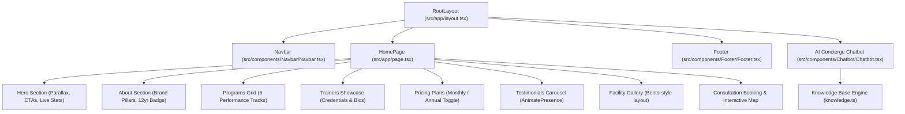

# 🏋️ FORGE FITNESS — SYSTEM SPECIFICATIONS

> **Version:** 1.0.0  
> **Status:** Production-Ready  
> **Live Deployment:** [https://forge-fitness-gym-seven.vercel.app/](https://forge-fitness-gym-seven.vercel.app/)  
> **Repository:** [Forge_Fitness_GYM](https://github.com/SainBux-HadiSeelro/Forge_Fitness_GYM.git)  
> **Framework:** Next.js 16 (Turbopack) & React 19  

---

## 1. Executive Summary

**Forge Fitness** is a premier, hyper-modern web application engineered for an elite athletic training and fitness facility. Built with a mobile-first philosophy, the platform integrates high-performance fluid animations, strict TypeScript typing, modern CSS modular architectures, and a 24/7 client-side AI Chatbot Concierge equipped with a comprehensive domain knowledge base.

---

## 2. Technology Stack & Environment

| Layer | Technology | Specification / Version |
| :--- | :--- | :--- |
| **Framework** | Next.js | `16.2.2` (Turbopack bundler, App Router) |
| **Runtime / UI** | React / React DOM | `19.2.4` (Strict React Server/Client separation) |
| **Language** | TypeScript | `^5.0.0` (Strict mode enabled) |
| **Animation Engine** | Framer Motion | `^12.38.0` (Hardware-accelerated viewport triggers) |
| **Styling** | Vanilla CSS Modules | Zero-runtime CSS Modules + CSS Custom Variables |
| **Linter / QA** | ESLint | `^9.0.0` (`eslint-config-next`) |
| **AI Concierge** | Custom Heuristic NLP | Real-time pattern matching & knowledge retrieval |

---

## 3. Architecture & Component Hierarchy



---

## 4. Design System & CSS Tokens

The visual language follows an aggressive, premium dark-mode aesthetic with high-contrast electric orange and neon accents:

### Color Palette
- **Background Primary:** `#080808` (Deep void black)
- **Background Secondary:** `#111111` (Matte graphite)
- **Card Background:** `#161616` (Elevated dark surface)
- **Primary Accent:** `#FF4500` (Blaze Orange)
- **Accent Hover:** `#e03d00`
- **Accent Glow:** `rgba(255, 69, 0, 0.3)`
- **Neon Highlight:** `#CFFF04` (Electric Lime)
- **Text Primary:** `#F0F0F0` (High-legibility soft white)
- **Text Secondary:** `#9A9A9A` (Muted silver)

### Typography
- **Headings:** `'Outfit', sans-serif` (Weights: 600, 700, 800, 900)
- **Body & UI:** `'Inter', sans-serif` (Weights: 300, 400, 500, 600)

---

## 5. Feature Breakdown

### 5.1 Hero Section
- **Dynamic Parallax:** `window.scrollY` transform interpolator applied to hero background image.
- **Micro-interactions:** Staggered entrance animations for eyebrows, main titles, dual CTAs, and performance stats.
- **Scroll Indicator:** Animated pulse indicator guiding visitors down the funnel.

### 5.2 Programs Grid
- Six distinct performance training programs:
  1. *Strength & Conditioning* (Progressive Overload)
  2. *Cardio & HIIT* (VO2 Max conditioning)
  3. *Personal Training* (1-on-1 private coaching)
  4. *Group Fitness* (30+ weekly classes)
  5. *Mobility & Yoga* (Active recovery & injury prevention)
  6. *Athletic Performance* (Pro sports speed & agility)
- Hover lift transformations and highlighted "Most Popular" card with glow effects.

### 5.3 Memberships & Billing Toggle
- Dynamic interactive billing switch: **Monthly** vs. **Annual (Save 25%)**.
- Three tiers:
  - **Starter**: $39/mo ($29/mo annual)
  - **Elite**: $79/mo ($59/mo annual) — Featured with golden badge
  - **Pro**: $129/mo ($99/mo annual)
- Visual feature checklist with positive checks and negative crosses.

### 5.4 Elite Coaches
- Dedicated coach profiles for **Marcus Cole** (Head Strength), **Sofia Reyes** (HIIT), and **James Okafor** (Athletic Performance).
- Displays certified credentials (CSCS, NSCA, NASM-CPT, CrossFit L2, USA Track).

### 5.5 Testimonials Carousel
- Powered by `framer-motion` `AnimatePresence`.
- Interactive previous/next slider with navigation dots and direct mini-card selectors.

### 5.6 Interactive Consultation Form
- Form handling client details: Name, Email, Phone, Primary Goal selector, and Message.
- Instant submission feedback state with responsive reset capability.

---

## 6. AI Chatbot Agent Specification

### 6.1 Purpose
The **Forge AI Concierge** is an interactive live agent designed to answer visitor inquiries instantly, provide complete facility data, guide users to relevant sections, and maximize conversion rates.

### 6.2 Knowledge Domain
- **Company Story:** 12-year history, 15,000+ members, 50+ coaches.
- **Location & Access:** 1250 Iron Ave, Downtown NY; 24/7 access details.
- **Operating Hours:** Weekdays 5am–11pm, Weekends 6am–10pm.
- **Pricing & Discounts:** Full breakdown of all 3 plans, savings, and terms.
- **Programs & Classes:** In-depth explanation of all 6 training tracks.
- **Facility Amenities:** Eleiko plates, 40-yd turf, recovery sauna, cold plunge, showers.

### 6.3 Technical Implementation
- Client-side heuristic parser (`findBotResponse`) eliminating API latency and token costs.
- Typing simulator with natural delay (550ms) and bouncing dot indicators.
- Quick action pills that trigger smooth viewport scrolls to anchor IDs (`#membership`, `#programs`, `#contact`).
- Strict purity adherence matching React 19 rules (zero impure function evaluations in render cycles).

---

## 7. Performance & Quality Benchmarks

- **Zero Lint Errors:** Fully compliant with ESLint 9 & Next.js strict configurations.
- **Turbopack Build Time:** Under 25 seconds full production compile.
- **Static Generation:** 100% static prerendering (`○ /`) for zero-latency TTFB and optimal SEO.
- **Bundle Optimization:** Modular component-scoped CSS eliminating global namespace collisions.

---

## 8. Development & Deployment Guide

```bash
# Clone the repository
git clone https://github.com/SainBux-HadiSeelro/Forge_Fitness_GYM.git

# Navigate into project directory
cd Forge_Fitness_GYM

# Install dependencies
npm install

# Start development server
npm run dev

# Run linting check
npm run lint

# Build for production
npm run build

# Start production server
npm run start
```
